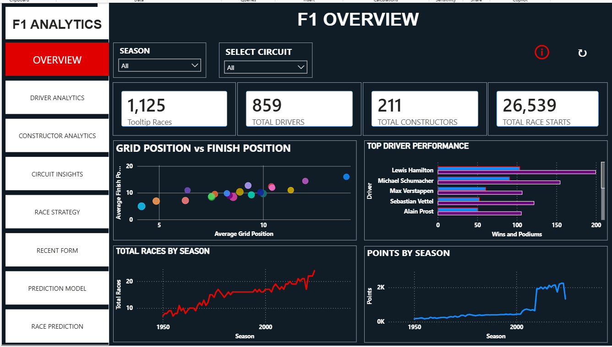
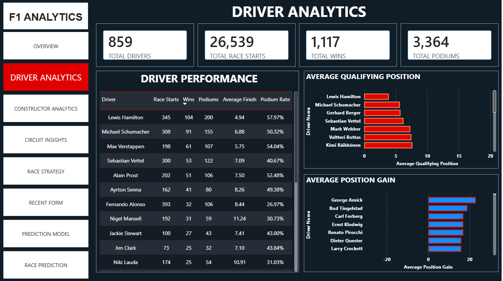
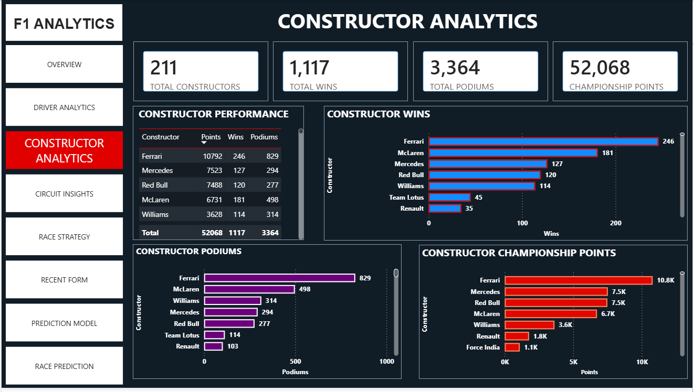
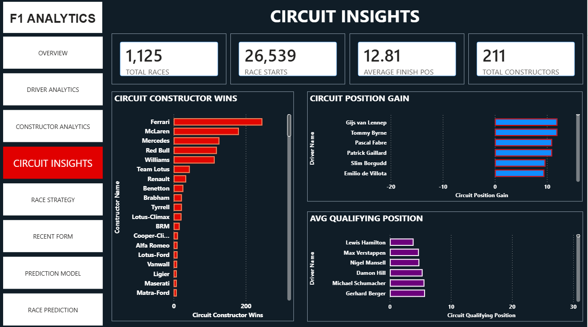
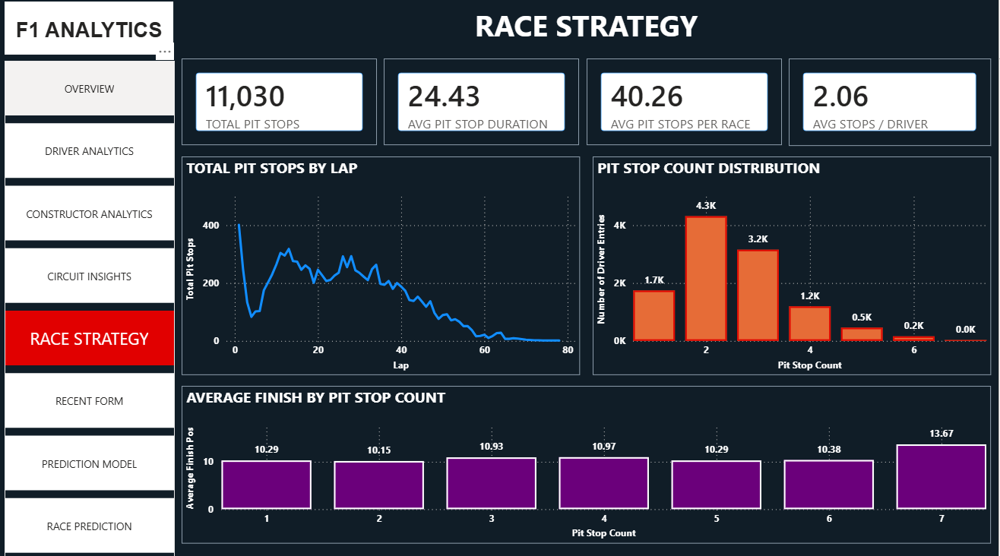
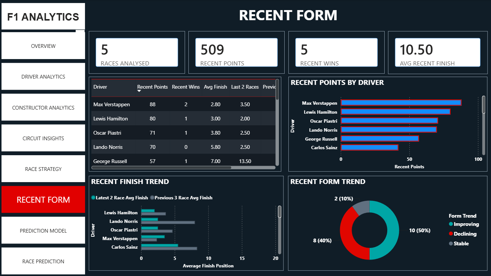
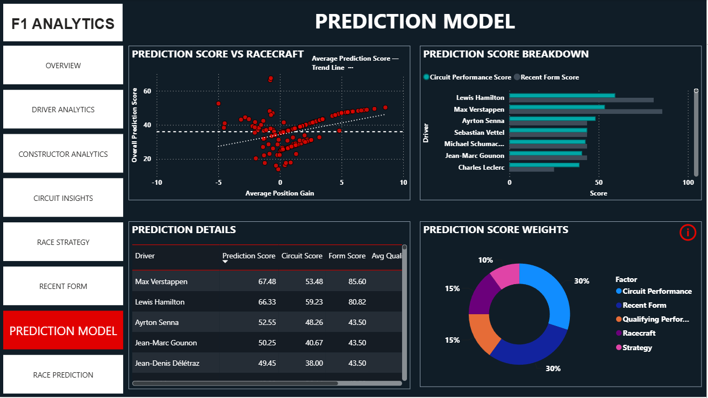
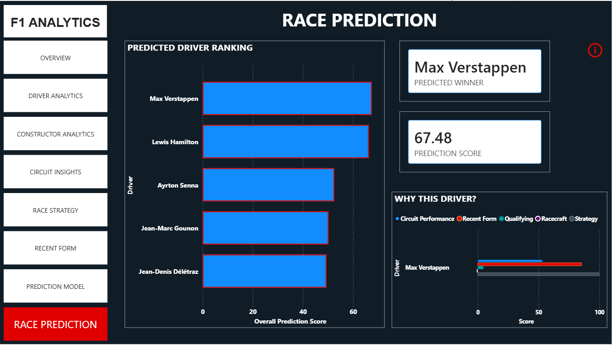
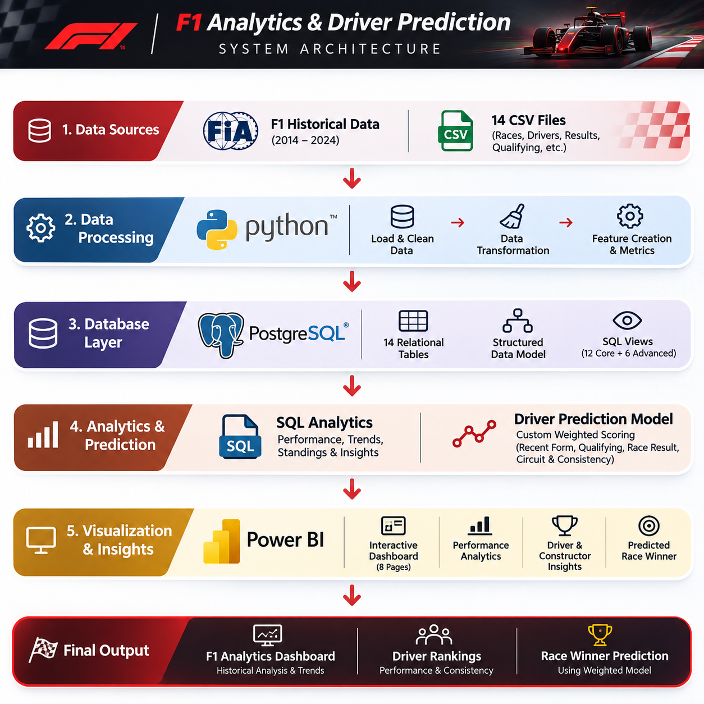

# F1 Analytics & Driver Prediction Dashboard

An end-to-end Formula 1 analytics project built using **Python,
PostgreSQL, SQL and Microsoft Power BI**, leveraging cleaned historical
F1 data to explore driver, constructor, circuit, race-strategy and
championship performance.

The project combines relational database management, analytical SQL
queries and interactive Power BI reporting.

A key feature is a **custom weighted Driver Prediction Model** that
combines historical circuit performance, recent form, qualifying
performance, racecraft and strategy to rank drivers and estimate
potential race winners.

------------------------------------------------------------------------

## Table of Contents

- [Dashboard Preview](#dashboard-preview)
- [Flagship Feature: Weighted Driver Prediction Model](#flagship-feature-weighted-driver-prediction-model)
- [Dashboard Modules](#dashboard-modules)
- [Database and SQL Analytics](#database-and-sql-analytics)
- [Dataset](#dataset)
- [Data Architecture](#data-architecture)
- [Technology Stack](#technology-stack)
- [Repository Structure](#repository-structure)
- [Setup and Installation](#setup-and-installation)
- [Reproducibility and Notes](#reproducibility-and-notes)
- [Author](#author)

------------------------------------------------------------------------

## Dashboard Preview

The Power BI dashboard contains eight interactive analytical pages.

### 1. Overview



### 2. Driver Analytics



### 3. Constructor Analytics



### 4. Circuit Insights



### 5. Race Strategy



### 6. Recent Form



### 7. Prediction Model



### 8. Race Prediction



------------------------------------------------------------------------

## Flagship Feature: Weighted Driver Prediction Model

The prediction score combines five components:

  Component                 Weight
  --------------------- ----------
  Circuit Performance          30%
  Recent Form                  30%
  Qualifying                   15%
  Racecraft                    15%
  Strategy                     10%
  **Total**               **100%**

The model presents driver rankings and a predicted winner, with
supporting factors that make the prediction score easier to interpret.

The weights are configurable within the Power BI model.

> This is a historical-data-based analytical model, not a guarantee of
> race outcomes or a live race prediction service.

------------------------------------------------------------------------

## Dashboard Modules

The Power BI dashboard contains eight analytical modules:

-   **Overview** --- high-level championship and race statistics.
-   **Driver Analytics** --- driver performance, wins, podiums and
    qualifying/race comparisons.
-   **Constructor Analytics** --- constructor performance and
    championship comparisons.
-   **Circuit Insights** --- circuit-level performance and
    qualifying/position-gain analysis.
-   **Race Strategy** --- pit-stop activity, timing and strategy
    comparisons.
-   **Recent Form** --- historical recent-performance analysis.
-   **Prediction Model** --- prediction score components, weights and
    driver comparisons.
-   **Race Prediction** --- predicted driver rankings, predicted winner
    and explanation of the prediction.

------------------------------------------------------------------------

## Database and SQL Analytics

PostgreSQL is used as the central relational database for storing and
analysing historical Formula 1 data.

-   **Database:** PostgreSQL
-   **Database name:** `f1_analytics`
-   **Tables:** 14
-   **Analytical SQL views:** 18
-   **Imported records:** 1,261,897

### Database tables

The database contains 14 tables:

  -----------------------------------------------------------------------
  Table                               Description
  ----------------------------------- -----------------------------------
  `seasons`                           Historical F1 seasons

  `circuits`                          Circuit details and geographical
                                      information

  `drivers`                           Driver information

  `constructors`                      Constructor and team information

  `status`                            Race result status descriptions

  `races`                             Race schedules and event
                                      information

  `results`                           Individual race results and
                                      performance metrics

  `qualifying`                        Qualifying session results

  `pit_stops`                         Pit-stop information

  `pit_strategy_summary`              Aggregated pit strategy information

  `lap_times`                         Individual lap timing records

  `driver_standings`                  Historical driver championship
                                      standings

  `constructor_standings`             Historical constructor championship
                                      standings

  `constructor_results`               Constructor race results and points
  -----------------------------------------------------------------------

### Analytical SQL views

The project implements 18 analytical views using PostgreSQL.

**Core analytical views:** - Driver performance analysis. - Constructor
performance analysis. - Race summaries. - Circuit performance. - Driver
qualifying performance. - Qualifying versus race-result comparisons. -
Pit strategy analysis. - Driver lap pace. - Driver championship
progress. - Constructor championship progress. - Detailed race
results. - Constructor race points.

**Advanced analytical views:** - Driver season rankings. - Constructor
season rankings. - Driver championship standings movement. - Constructor
championship standings movement. - Driver circuit rankings. - Driver
racecraft analysis.

### SQL concepts demonstrated

-   Relational database design.
-   Primary and foreign keys.
-   Indexing.
-   Joins and aggregations.
-   Common Table Expressions (CTEs).
-   Window functions.
-   `RANK()` and `DENSE_RANK()`.
-   `LAG()` and `PARTITION BY`.
-   Reusable analytical views.

------------------------------------------------------------------------

## Dataset

The project uses cleaned historical Formula 1 datasets in CSV format as
the original data source.

The dataset package contains 14 files:

-   `seasons_clean.csv`
-   `races_clean.csv`
-   `results_clean.csv`
-   `drivers_clean.csv`
-   `constructors_clean.csv`
-   `circuits_clean.csv`
-   `qualifying_clean.csv`
-   `pit_stops_clean.csv`
-   `driver_standings_clean.csv`
-   `constructor_standings_clean.csv`
-   `constructor_results_clean.csv`
-   `status_clean.csv`
-   `lap_times_clean.csv`
-   `pit_strategy_summary.csv`

The cleaned datasets are imported into PostgreSQL and organised into
relational tables.

The database uses identifiers such as race, driver, constructor and
circuit IDs to establish relationships between datasets.

### Data validation

The imported PostgreSQL database was validated using SQL queries.

-   Verified row counts across all 14 tables.
-   Checked race, driver and constructor references in the results
    table.
-   Confirmed zero missing references in the three tested relationships.

**Total imported records: 1,261,897**

------------------------------------------------------------------------

## Data Architecture

The diagram below illustrates the end-to-end flow from historical Formula 1
datasets through Python data preparation, PostgreSQL storage, SQL analytics
and the Power BI reporting layer.



**Pipeline overview:**

1. **Data sources:** Original historical Formula 1 CSV datasets.
2. **Data processing:** Python and Pandas for data preparation and cleaning.
3. **Database layer:** PostgreSQL with 14 relational tables.
4. **Analytics layer:** 12 core and 6 advanced SQL views for reusable analysis.
5. **Visualization:** Power BI Desktop, Power Query and DAX measures, including
   the weighted driver prediction model.

Power BI connects to PostgreSQL using Power Query. The dashboard uses
historical data and does not consume live race feeds or live telemetry.
The SQL views provide an additional reusable analytical layer.

------------------------------------------------------------------------

## Technology Stack

| Technology | Role in the project |
|---|---|
| **Python** | Data preparation workflow |
| **Pandas** | Reading, cleaning and manipulating CSV datasets |
| **PostgreSQL** | Relational database for the historical F1 datasets |
| **SQL** | Schema creation, joins, aggregations and analytical views |
| **Microsoft Power BI Desktop** | Interactive dashboard and reporting |
| **Power Query** | PostgreSQL connectivity and data transformation |
| **DAX** | Dashboard measures and weighted driver prediction calculations |
| **Git and GitHub** | Version control and project publishing |

------------------------------------------------------------------------

## Repository Structure

```text
F1-Analytics/
│
├── data/
│   ├── raw data/
│   └── cleaned data/
│
├── screenshots/
│   ├── 01-overview.png
│   ├── 02-driver-analytics.png
│   ├── 03-constructor-analytics.png
│   ├── 04-circuit-insights.png
│   ├── 05-race-strategy.png
│   ├── 06-recent-form.png
│   ├── 07-prediction-model.png
│   ├── 08-race-prediction.png
│   └── system_architecture.png
│
├── python/
│   └── clean_data.py
│
├── sql/
│   ├── create_tables.sql
│   ├── analytics_views.sql
│   └── advanced_analytics.sql
│
├── docs/
│   ├── architecture.md
│   ├── database_schema.md
│   └── sql_views.md
│
├── powerbi/
│   └── F1_Analytics_Dashboard.pbix
│
├── requirements.txt
├── .gitignore
└── README.md
```

The Python script is included as a reproducibility aid. The existing cleaned
CSV files, PostgreSQL database and completed Power BI report are preserved;
running the script is not required to use the current project deliverables.

------------------------------------------------------------------------

## Setup and Installation

### 1. Clone the repository

``` bash
git clone https://github.com/<your-username>/<your-repository>.git
cd <your-repository>
```

### 2. Set up the Python environment

**Windows (PowerShell):**

``` powershell
python -m venv .venv
.venv\Scripts\Activate.ps1
```

**macOS / Linux:**

``` bash
python3 -m venv .venv
source .venv/bin/activate
```

### 3. Install Python dependencies

``` bash
python -m pip install --upgrade pip
pip install -r requirements.txt
```

### 4. Set up PostgreSQL

-   Install PostgreSQL and pgAdmin 4.
-   Create a database named `f1_analytics`.
-   Execute `sql/create_tables.sql`.
-   Import the 14 cleaned CSV datasets into their corresponding tables.
-   Execute `sql/analytics_views.sql`.
-   Execute `sql/advanced_analytics.sql`.

The SQL scripts are organised in execution order.

### 5. Connect Power BI to PostgreSQL

-   Open the Power BI report in Power BI Desktop.
-   Connect to the PostgreSQL database.
-   Configure the local PostgreSQL connection and credentials.
-   Refresh the report to retrieve the database records.

The Power BI report uses the PostgreSQL database as its data source.

------------------------------------------------------------------------

## Reproducibility and Notes

-   PostgreSQL must be installed and configured locally before
    refreshing the report.
-   Update database connection settings when using a different
    PostgreSQL server.
-   Keep source CSV column names and identifier fields consistent with
    the Power BI model.
-   The Power Query layer maintains compatibility between PostgreSQL
    column naming and the existing Power BI model.
-   The prediction weights should add up to 100%.
-   Prediction outputs should be interpreted as estimates based on
    selected historical performance features.
-   Do not commit database passwords, credentials, local environment
    folders or other sensitive configuration files.
-   Check the original dataset provider's licensing and attribution
    requirements before redistributing source data.

------------------------------------------------------------------------

## Author

Akshay Murali

M.Sc. Computer Science

GitHub: [AkshayM2503](https://github.com/AkshayM2503)

------------------------------------------------------------------------

*This project demonstrates an end-to-end data analytics workflow
combining Python-based data preparation, PostgreSQL database design,
analytical SQL and interactive Power BI reporting.*
